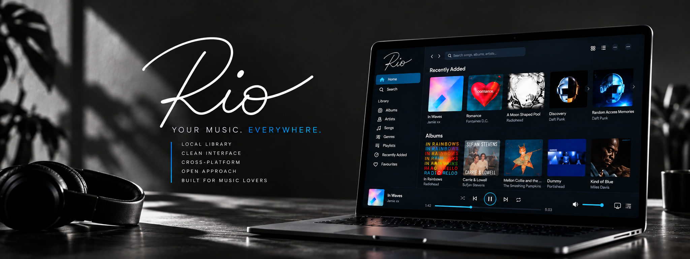

<p align="center">
  
</p>

# Rio 0.1

A local personal music library and player for macOS and Linux, built around music you own. The desktop interface follows `artfiles/rio-desktop-prototype.png`.

Rio’s long-term scope includes macOS, Windows, Linux, Android, iOS, and cloud synchronization/access across your devices. Version 0.1 implements local desktop functionality. [PRODUCT.md](PRODUCT.md) is the product authority; the promotional landing page is not an implementation specification.

## What works

- First-run library setup with a folder you explicitly choose; no preconfigured music or sample database.
- Recursive music indexing with metadata and embedded artwork; source originals remain read-only.
- Optional managed copying into a configured Rio Media folder, with new-copy organization and explicit referenced/managed ownership.
- Persistent Albums, Artists, Songs, Genres, Recently Added, Favourites, and Playlists views.
- Shared virtualized Track List in Songs, playlist contents, Artist/Genre track views, Favourites, search, and library list mode. Sortable metadata includes title, duration, artist, album, genre, BPM, bit rate, format, disc, track, comments, and year. Column order, widths, and visibility are global and persistent.
- Search across title, artist, album, album artist, genre, comments, and codec; album sorting and genre filtering.
- Album details and track list; play/pause, previous/next, seeking, time, volume/mute, shuffle, and repeat.
- Queue inspection, play-next, add/remove queue entries, and persistent listening state.
- Create, rename, delete, and add/remove songs from playlists.
- Right-click a sidebar playlist for native **Export Playlist…**, **Duplicate Playlist** and **Delete Playlist…** actions. Actions target that playlist without opening it. Copies have independent identities and ordered memberships; native deletion confirmation preserves library tracks and audio. See [PLAYLIST-CONTEXT-MENU.md](docs/PLAYLIST-CONTEXT-MENU.md).
- Native track context menus for playback, queue, playlists, favourites, read-only Track Info and confirmed selection-based library removal; File → New Playlist (Command/Ctrl+N).
- Native album context menus retain collection actions and add **Delete Album…** plus macOS **Show in Finder**, using the album's exact identity and the existing guarded track-removal engine.
- File → Import Playlist accepts UTF-8 M3U/M3U8 and safely indexes new local audio; File → Export Playlist writes M3U8 in playlist order.
- Drop local audio files/folders to add them using the selected reference/copy policy; drop M3U/M3U8 playlists to import them; drag library tracks onto sidebar playlists. macOS Open With/Dock playlist opens queue safely through startup or library setup.
- Manual folder rescanning, import reports, missing-file indication, and playback errors.
- Native folder dialogs, application menus, media-session integration, keyboard focus, and desktop window resizing.
- Persistent collection summaries above playback: Songs and track collections show count, indexed duration and audio-file storage; album grids show established album identities and storage. Selection and sorting leave totals unchanged. See [LIBRARY-SUMMARY.md](docs/LIBRARY-SUMMARY.md) for scope, units and unknown metadata.

## Run from source

Use **Node.js 24 LTS or newer**, npm, and macOS 13+ or a current desktop Linux distribution. The tested host is Intel macOS 15.8.1. On Linux, Electron also needs the usual GTK/NSS/audio/graphics libraries and a graphical session; see the CI workflow for Ubuntu 24.04 dependencies.

```sh
npm ci
npm run dev
```

`dev` makes a production build and launches it. It does not run a hot-reload server. After editing, rerun it. `npm start` launches the last build. Nothing is committed or pushed by these commands.

Quit any running Rio application before launching a source build, including an installed copy in Applications. Closing its window on macOS does not quit it. Source and installed builds share the default profile and single-instance lock; a blocked source launch now exits with an explanatory error rather than silently leaving you in the older running app. For manual verification after edits, run `npm run build` and then `npm start`; confirm that the terminal stays attached to the new app. `RIO_DATA_DIR` may select a separate disposable profile for isolated testing.

## First launch

1. Select **Choose library folder**. Create or select an ordinary folder for Rio’s database. It can be separate from your music. New libraries automatically get a **Rio Media** folder inside the library folder. Select an existing Rio folder to reuse its saved media location.
2. Select **Add music folders** and choose one or more music directories. Rio indexes them in place by default. To copy new additions instead, enable copying in Library settings.
3. Select an album for its track list, or use its play button. In Songs, click to select, Shift-click for a range, Command/Ctrl-click to toggle, and double-click to play. Right-click a track for actions. Drag headers to rearrange metadata columns; click a header to sort. Drag column boundaries to resize; use Library Settings → Track List columns to show/hide metadata. Presentation is shared globally; playlist order and each view's sort/selection remain independent. The first column stays visible when it fits, and horizontal scrolling exposes the rest.
4. Use **Library settings** to add music, rescan folders, switch libraries, or use **Move Library…** to relocate the library environment. Rescan after external changes, or use Locate File for a missing track.

New-library media setup creates/configures `Rio Media` inside the library folder, with copying still off by default. Existing libraries reuse their saved root only after directory, recorded device/inode, canonical-path and access validation. An unavailable drive, missing/unsafe root or absent configuration opens Library settings for recovery; Rio retains the saved location and never recreates or substitutes an existing library's unavailable media root. Reconnect the drive and reopen the library, or explicitly choose a folder in Settings. Changing roots does not move files or adopt unknown files as managed. See [library setup](docs/LIBRARY-SETUP.md) for the setup and recovery contract.

Rio never writes to, moves, renames or deletes your external source audio files. Copying is opt-in. Confirmed Delete from Library removes a referenced track from Rio only; a verified managed copy moves to the OS Trash. No permanent audio deletion, tag editing or existing-file reorganization is implemented. Deleting a playlist only deletes its database records.

To exchange playlists, use **File → Import Playlist…** or **File → Export Playlist…**. M3U/M3U8 can also be dropped into the app or opened with Rio from Finder. On a first launch without a library, file-open requests wait until one is chosen. Export uses the current playlist; from another view it asks which playlist to export. Relative import paths resolve beside the playlist file. Export uses relative paths for audio inside the export folder's tree and absolute paths for external locations. Spaces/Unicode and local `file:` URLs are supported; streaming URLs are reported and skipped. Missing or invalid entries produce a report while available songs retain their order. Existing playlist names receive a numeric suffix; repeated references use Rio's existing unique-membership rule. Audio remains in place. Legacy non-UTF-8 M3U files must be resaved as UTF-8 before import.

**Move Library…** copies and verifies the library and internal media directly in the exact empty destination folder you select, reopens it, and switches the saved library location. External media roots and referenced sources stay in place. The old environment is retired in place as a recovery copy; it is not automatically deleted. See [library relocation](docs/LIBRARY-RELOCATION.md) for scope, recovery, space requirements and limitations.

## Optional managed copies

In **Library settings**, use the automatically configured **Rio Media folder** or choose another dedicated folder, then enable **Copy files to Rio Media folder when adding to library**. Originals stay unchanged; Add Music and audio/folder drops index verified copies. **Keep Rio Media folder organized** puts new copies under Album Artist/Album with track-number filenames. Turning it off uses sanitized original filenames in the root. Neither changing the folder nor toggling organization moves existing files.

The default is reference-in-place. Playlist imports and rescans never initiate copying. Unknown files already inside the media folder stay referenced rather than being adopted as managed. Settings show managed/referenced counts; the existing track file-information dialog shows its relationship and current path.

Collisions receive numbered suffixes without overwriting audio. Re-adding the same original bytes reuses its managed track; different source paths are not globally deduplicated by content. An unfinished import is reported and can be retried by adding its original again with copying enabled. Do not manually remove hidden staging files or relocate managed copies during an import. See [ITERATION-3.md](docs/ITERATION-3.md) for receipt/recovery limits and a test-media-only acceptance procedure.

## Recover and consolidate

A missing track exposes **Locate File…** in its playback error and native track context menu. Referenced tracks relink to the selected supported audio file without copying it. Managed tracks restore a verified copy into the selected Rio Media folder; the selected recovery source stays unchanged. A file returned to its expected managed path can be revalidated there. Recovery retains track identity, playlists, favourites and listening state. Rescanning/restoring also resets an errored decoder so the same track can play again. Rio does not search your filesystem automatically.

Right-click referenced tracks (including a mixed multi-selection) for **Consolidate to Rio Media**, or an album for **Consolidate Album to Rio Media**. **File → Consolidate Library…** and the matching Library Settings action explain the copy operation and require confirmation. These explicitly requested copies work independently of copy-on-add. Already-managed tracks are skipped, so repeated consolidation creates no duplicate copies. Each successful track commits separately; failures remain referenced, with aggregate counts and retry details. Locate a missing original and run consolidation again to retry remaining referenced tracks. **Rescan Folders never consolidates.**

Rio's management authority ends at its configured media environment. External files remain user-owned: Locate and consolidation allow reading/copying, never moving, renaming, deleting, reorganizing or tag-writing the external original. See the Iteration 3 report for sacrificial-media-only acceptance and limitations.

## Track information

Right-click a track and choose **Track Info…** to inspect stored metadata, file path, referenced/managed ownership and availability. In a multi-selection it shows the clicked row while preserving the selection; keyboard context activation uses the focused row. This works across the shared Track List views. There is no trailing action column and no metadata editing/tag writing. Composer, track/disc totals and play count are omitted because the current model does not store them.

On macOS, **Show in Finder** reveals the clicked track's currently resolved audio file, for both references and managed copies. It only navigates; it does not change the file or ownership. A missing/unavailable audio file produces an error with a Locate File suggestion, without opening a fallback folder.

Locate updates the existing referenced track, including when copy-on-add is enabled. If the selected file already belongs to a different existing track, recovery rejects it and leaves both identities intact; it never silently merges or removes records.

## Removing tracks

Right-click a track in a playlist for **Remove from Playlist** (membership only) or **Delete from Library…** (complete Rio identity). Other track contexts offer only Delete from Library. These commands act on the current selection. Command-click on macOS (Control-click on Linux/Windows) toggles rows; Shift-click selects a range. Right-click inside a selection preserves it, while right-click outside it selects that row. Track Info and Show in Finder remain single-row actions.

Delete from Library asks once for the entire selection, explicitly counting managed copies that will move to Trash and references whose originals stay untouched. Referenced audio stays at its original location. A managed copy is moved to the operating system Trash only after root/path, file identity and import-receipt validation; a database pathname alone grants no Trash authority. All playlist memberships, favourite state and queue references are removed. Deleting the current track stops playback and clears the player. Cancellation changes nothing; a Trash failure retains the identity. A database failure after Trash explicitly reports the partial outcome and retains the entry for recovery using Trash or Locate File. Missing, replaced or unverifiable managed copies are retained with an error rather than silently removed. Bulk execution continues with other tracks, reports the removed/retained counts and failure reasons, and cleans queue/player state only for successful deletions. An affected current file already moved to Trash is paused even if its identity had to be retained.

Only dedicated sacrificial media should be used for initial manual acceptance. See [TRACK-REMOVAL.md](docs/TRACK-REMOVAL.md) for tests, recovery limits and the acceptance checklist. Explicit rescanning of a retained source folder may index a previously removed referenced file again; this feature does not create exclusion rules.

Right-click an album card or its opened details artwork/heading for **Delete Album…**. It removes every track in that exact album identity, with one album-named confirmation counting managed copies and references. It uses the same safety, partial-failure and playback-cleanup rules as track removal. On macOS, album **Show in Finder** reveals its actual audio directory; multiple directories or partially missing files first show an explicit folder/count summary. All-missing albums show an error without revealing a fallback folder. Track-row right-clicks keep their selection-aware track actions. See [ALBUM-ACTIONS.md](docs/ALBUM-ACTIONS.md) for identity, location and acceptance details.

After successful managed album deletion, Rio removes the resulting genuinely empty managed directory chain, including album/disc and artist folders, using non-recursive cleanup. Other albums, unknown files or subdirectories stop upward cleanup. The sole exception is a recognized regular Finder `.DS_Store` file: if it is the directory’s only remaining entry, Rio moves it to native Trash before attempting empty-directory removal. A filename alone is insufficient; linked, malformed or changed files are retained. Referenced/external trees and registered media roots—including nested/historical roots—are never removed. Cleanup warnings are reported separately and do not change successful track-deletion results.

## Formats and artwork

Indexed extensions: MP3, FLAC, M4A, AAC, Ogg, Opus, WAV, AIF, and AIFF. Files need a recognizable audio stream. Codec support, not the extension alone, determines playback: packaged-app checks on macOS exercised PCM WAV, FLAC, MP3, AAC in M4A, raw AAC, Ogg Vorbis, and Opus. DRM-protected audio is unsupported. AIFF may index but fail playback in Chromium; convert it yourself if needed. Your real-library codec variants still need evaluation on each OS.

Embedded JPEG, PNG, and WebP artwork up to 10 MB is cached. Missing artwork gets a neutral disc placeholder. External `cover.jpg`/folder images are not searched. No commercial album artwork is bundled.

## Data storage and safety

The folder you select contains `rio.sqlite` plus SQLite WAL/SHM sidecars while open. It holds tracks, source paths, cached artwork, playlists, favourites, and player settings. Close Rio before backing up or copying the library folder. The database contains absolute paths and is not a portable synchronization format.

Global Track List settings are stored in `view-preferences.json` beside the application-data pointer. Existing library-scoped Songs order migrates once when no global layout exists.

A `library.json` pointer is stored in Electron’s user-data directory: normally `~/Library/Application Support/Rio` on macOS and `$XDG_CONFIG_HOME/Rio` (usually `~/.config/Rio`) on Linux. `RIO_DATA_DIR` overrides only the pointer/application-data location for isolated development and testing; it does not preconfigure a music library.

An existing unrelated SQLite database is rejected. Disconnected or unreadable roots produce errors rather than erasing library records. Symlinks and hidden entries are skipped. Same canonical paths are indexed once; content-duplicate detection is not implemented. Unreconciled external file moves produce a missing old entry and a new record; new IDs are independent of local paths. Rio does not repair playlists across moves automatically.

Rio retains the schema-1/2 to schema-3 migration for databases carrying its own application identifier, marking prior tracks as referenced and preserving playlists, favourites, track identities, and listening state. This pre-release rename starts with a separate Rio profile and `rio.sqlite`; it does not import the earlier working-name application data. Use **Library settings → Rescan folders** after upgrading to populate BPM, comments, bit rate, and codec for previously indexed tracks. Missing tags display an em dash. Close the app and back up the library folder before upgrading; older schema-1/2 applications cannot open a migrated library.

No telemetry, streaming service, login, or cloud connection is implemented. The sandboxed UI loads local resources and indexed audio only.

## Test and verify

```sh
npm run typecheck
npm test
npm run test:desktop
# After packaging:
npm run test:packaged
# Optional: FFmpeg-backed checks of five additional codecs
npm run test:codecs
```

Unit tests cover empty/reopened libraries, database ownership, schema migration, tagged metadata, source safety, indexing, duplicates, malformed files, unavailable/missing paths, album grouping, atomic playlist transactions, column sorting, drag payload validation, state validation, and byte-range audio transport.

`test:desktop` launches real Electron windows against temporary synthetic audio and temporary application data. It tests setup, indexing, playback/seek, search, playlist/favourites/queue, genre/artist views, rescan, and restart persistence. Folder-dialog responses are automated with temporary paths; native picker interaction remains a manual check. It produces screenshots in `.impeccable/review/` and removes its temporary library afterward. FFmpeg is optional: when available, it generates FLAC with embedded synthetic artwork; otherwise the test uses WAV. On headless Linux, use `xvfb-run -a npm run test:desktop`.

The same command also runs the feature suite: playlist focus, native menu callbacks, table selection/sorting, real disk-file/folder drops through preload, multi-track playlist drops, restart, source hashes, and a 10,014-track rendering benchmark. Run just that suite with `npm run test:features`. Native menus are exercised through their actual commands with popup display intercepted in the isolated test process; Finder/Linux file-manager gestures and menu appearance still need manual evaluation.

It also runs `scripts/interchange.mjs`: pointer header dragging, column-order restart, sorting/keyboard playback after reordering, File-menu import/export, missing-entry reports, Unicode/space paths, newly indexed audio, export/import round trips, dialog cancellation, and source hashes. `npm run test:interchange` runs that suite alone. `scripts/acceptance.mjs` adds pointer resizing, visibility/restoration, legacy migration, shared cross-view presentation, independent playlist ordering, mixed playlist/audio/folder drops, queued startup/running file opens, alias deduplication, and first-run deferral. `npm run test:acceptance` runs it alone. `test:packaged` exercises the desktop integration suites against the built application, excluding source-only startup checks. `scripts/managed.mjs` also covers media-folder configuration/cancellation, managed copying/playback, repeats, playlist reference semantics, restart, compact settings and source hashes. Run it alone with `npm run test:managed`. The sixth suite, `scripts/recovery.mjs`, tests referenced/managed Locate, actual recovered playback, native single/multi/album consolidation, whole-library confirmation, partial failure/retry, idempotency and hashes; run it alone with `npm run test:recovery`. The seventh suite, `scripts/track-info.mjs`, verifies exact one-track Locate, pre-existing collisions, playback/restart, read-only Track Info fields and shared-view/multi-selection context behaviour; run it alone with `npm run test:track-info`. See [ITERATION-3.md](docs/ITERATION-3.md) for current contracts and results.

`scripts/albums.mjs` adds native album targeting, exact album identity, Finder folder/missing policies, counted album deletion/cancellation, guarded managed Trash, mixed partial failure/recovery and relationship/playback/restart checks. Run it alone with `npm run test:albums`; it is included in both complete desktop commands. See [ALBUM-ACTIONS.md](docs/ALBUM-ACTIONS.md) for coverage and acceptance.

The test audio is silence, so automated playback verifies decoding, transport, time advancement, and seeking, not audible output quality. Evaluate sound and your audio device manually.

## Build and install on macOS

```sh
npm ci
npm run dist:mac -- --publish never
```

On Intel macOS this produces `release/mac/Rio.app`, `release/Rio-0.1.0.dmg`, and `release/Rio-0.1.0-mac.zip`. Apple Silicon hosts build their native architecture; filenames gain architecture suffixes where required by the packager. You can also request a specific architecture with the packager CLI after building.

Open the DMG and drag Rio into Applications, then launch it. Alternatively copy `release/mac/Rio.app` to Applications. Development packages are **unsigned and unnotarized**. On your own trusted build, macOS may require the Finder **Open** action or **System Settings → Privacy & Security → Open Anyway**. No signing identity was provided. The installer does not alter security settings.

`npm run pack` creates a directory bundle without distribution archives. The app bundles Electron; users do not need Node.js or FFmpeg installed.

## Build and install on Linux

Build Linux packages natively so the publication addon matches the target OS and architecture. The existing Ubuntu workflow runs this validation; Linux runtime execution is unavailable on the current macOS host:

```sh
npm ci
npm run typecheck
npm test
npm run dist:linux -- --publish never
```

On an x64 Linux host, install with either:

```sh
chmod +x release/Rio-0.1.0.AppImage
./release/Rio-0.1.0.AppImage
```

or:

```sh
sudo apt install ./release/rio-desktop_0.1.0_amd64.deb
rio-desktop
```

AppImage requires FUSE on some distributions; with a compatible runtime, `--appimage-extract-and-run` is an alternative. Do not run Rio as root or disable Chromium’s sandbox. Electron’s sandbox may require appropriate distribution user-namespace settings. `.github/workflows/build.yml` runs checks and packaging natively on macOS and Ubuntu when triggered; it does not publish releases.

This iteration was developed and run on macOS. The user reports the preceding checkpoint passed macOS and Ubuntu CI; the new suites must now pass there too. See [ITERATION-3.md](docs/ITERATION-3.md) for current results and [VALIDATION.md](docs/VALIDATION.md) for the original checkpoint. macOS is the active Phase 1 development target; the existing Ubuntu workflow remains a portability canary.

## Current limitations

- No cloud sync, mobile clients, Windows release, metadata editing, or automatic filesystem watching in 0.1.
- No gapless/crossfade, ReplayGain, equalizer, audio-device picker, or bit-perfect output guarantee. Volume uses the operating system’s default output device.
- No playlist track-reorder UI, tag writing, automatic reorganization of existing files or CD import. A queue contains unique tracks and supports basic next/add/remove operations. Playlist interchange is local-file UTF-8 M3U/M3U8 only; repeated song references collapse to their first occurrence.
- Track List presentation is application/profile-global. Sort/selection/scroll are local mounted-view state and reset to the view's defaults when re-entered. Side-panel queue/album rows retain their compact layout and share the same selection model and contextual action scope. Their selections reset when switching albums or between album/queue surfaces; Show more preserves the selection anchor. Plain row/title clicks select, while play controls, double-click and Enter play.
- Metadata is cached by file size, modification time, and extraction version; a migration may require one rescan to backfill new fields. Only embedded artwork is used.
- SQLite artwork caching can grow the database for large collections. No cache-size UI or automated pruning yet.
- Songs rendering was checked with 10,014 synthetic records, not a full large-collection import benchmark. Snapshots and sorting still process the full collection; synchronous SQLite writes can cause latency and scans have no cancel control. The right panel initially shows 200 tracks with a Show more control.
- Import issues show at most the first 100 failures. Source permission errors are reported, not repaired.
- State checkpoints every four seconds; abrupt termination may lose a few seconds. Restart restores selection/position without autoplay.
- Licensing is still undecided. Runtime dependencies retain their own licenses.

## Project layout

- `src/domain/` — library persistence, indexing, metadata normalization, playlist rules.
- `src/shared/` — shared types and player-state defaults.
- `src/main/` — desktop shell, preload bridge, local protocols, dialogs, and menus.
- `src/renderer/` — React interface and prototype-derived styles.
- `tests/` — isolated library and transport tests and synthetic WAV generator.
- `scripts/` — desktop smoke/codec checks and reproducible app-icon generator.
- `build/` — original generated application icon.
- `docs/ARCHITECTURE.md` — decisions, security boundary, and trade-offs.
- `docs/ORIGINAL_SPECIFICATION.md` — preserved early discovery document; superseded where PRODUCT.md differs.
- `artfiles/` — original design assets, preserved.

## Useful real-world evaluation

Try a small folder first, with tagged and untagged files, compilations, multiple discs, different codecs, and embedded artwork. Check audible output, seek/next behavior, long titles, search, playlists and restart. Disconnect an external drive and rescan, then reconnect and rescan. For very large libraries, evaluate import time, responsiveness, and database size before indexing the whole collection.

## Branding

Original owner-supplied artwork: `artfiles/rio-logo-white.png`. The desktop/mobile design references are `artfiles/rio-desktop-prototype.png` and `artfiles/rio-mobile-prototype.png`. The README uses `assets/rio-github-banner.png`. Run `npm run icons` to regenerate the separate UI wordmark and PNG application icon; on macOS it also regenerates ICNS using system tools. Node handles the PNG derivatives without a new image dependency. Never overwrite the original artwork. The repository directory and GitHub repository name are unchanged by the pre-release product rename.

See [the rename report](docs/RIO-RENAME.md) for identifiers, validation, preserved historical records and the complete file manifest.
