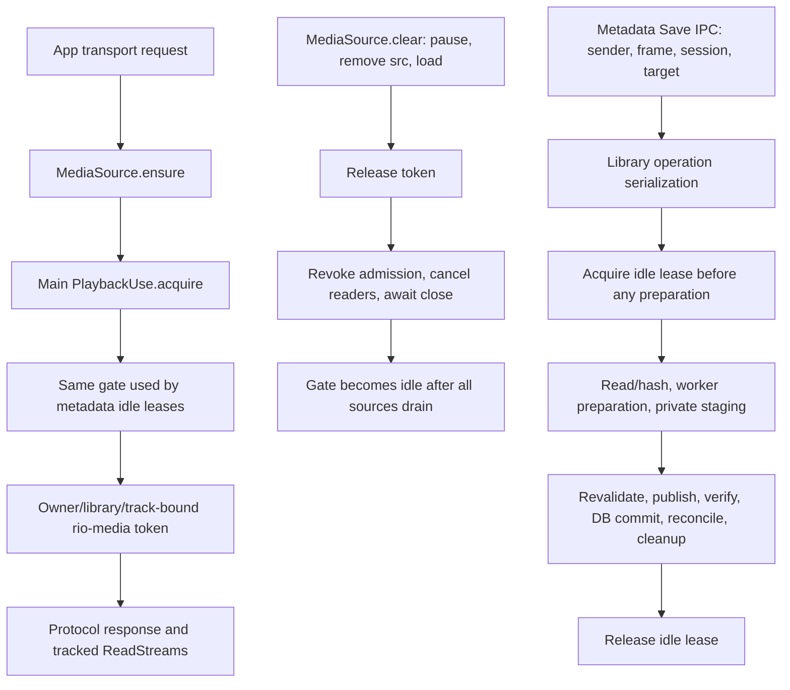

# Playback-compatible metadata editing — Phase 2E.1

## Conclusion

Read-only preparation can coexist with real FLAC playback. A controlled
release, token revocation, descriptor drain, unchanged publication pipeline and
position restoration is feasible. The Phase 2B idle gate need not be weakened.

This does **not** yet justify promising a brief interruption for every file.
For the generated 44.49 MB fixture, the timing repeat held exclusive use for
1.84–2.08 seconds on external APFS `noowners`, and 3.17–3.47 seconds with the
ownership-enabled APFS staged publisher. Observed decoder interruption was
2.02–3.09 seconds and 3.74–4.18 seconds respectively, including experiment
controller overhead. Source release and reopening are much cheaper than the
publication, verification and reconciliation that must remain exclusive.

No production feature, eligibility change or editing IPC was implemented.
The isolated source-app proof of concept is
[`scripts/research/metadata-playback-feasibility.mjs`](../scripts/research/metadata-playback-feasibility.mjs).
It uses a temporary coordinator copy and an isolated transport, not Rio's Track
Info/inline Save UI. Production still rejects edits of active/paused sources.

## Current ownership



The real boundaries are in `App.tsx`, `renderer/media-source.ts`,
`main/playback-use.ts`, `main/media.ts`, `main/main.ts` and
`domain/metadata-edit.ts`. `HTMLAudioElement` owns the decoder; the main process
owns the actual file descriptors. Queue/current IDs are references. Pausing,
buffer exhaustion or EOF is not a release acknowledgment.

`MediaSource.clear()` resets the controlled element and schedules token release,
but currently returns `void`. A caller cannot treat its return as confirmed
drainage. Main retires authorization synchronously, then waits for all tracked
readers, including those awaiting stat/open, before making the gate idle.
This uses the media [load/reset algorithm](https://html.spec.whatwg.org/multipage/media.html#dom-media-load)
and actual [stream close completion](https://nodejs.org/api/stream.html#event-close_1),
rather than elapsed time or the appearance of the player.

There are three additional boundaries beyond moving `acquireIdle`:

- `Library.media()` hides **every** nonterminal metadata journal. Playback
  range requests and new grants would therefore fail during preparation even
  if the early idle lease were removed.
- `PlaybackUse.edits` currently tracks the idle lease's lifetime. Deferring
  that lease without another whole-operation registration creates an untracked
  preparation interval during shutdown.
- `App.tsx` has source preparation/preload effects, transport request generations,
  desired-play state, saved-position state and error recovery. A stable track ID
  and pathname do not automatically retrigger source loading after an edit.

## Proposed preparation/publication boundary

Read-only source validation, bounded reading/hashing, worker candidate rendering,
encoded-audio/metadata verification and private staged-file preparation can run
while playback retains its token. The staged native publisher opens the original
read-only and prepares independent private candidate/rollback files; it does not
exchange the authoritative pathname at that point. The in-place strategy likewise
prepares verified candidate bytes before touching the authoritative FLAC.

The safe handoff is **after candidate preparation and any private staging
verification, before authoritative revalidation/publication**:

1. Reserve admission for that library epoch and track synchronously. New grants
   must be denied or retained as one bounded transport intent before any await.
2. Capture the latest actual track, playhead, playing/paused state and transport
   revision. Reset the controlled element; acknowledge release, revoke every
   relevant token and drain all actual readers.
3. Acquire the existing genuine idle lease. Repeat active-library/owner/session,
   managed-FLAC, settings, receipt, root/path and native fingerprint checks at
   this boundary. Earlier validation is evidence to recheck, not lasting authority.
4. Run the existing publisher and all post-publication verification, SQLite
   receipt/catalog updates, reconciliation and cleanup. Retain exclusivity.
5. Reopen only after the journal/catalog is playable and the idle lease is
   released. Obtain a fresh token; await real metadata/seek/canplay readiness.
   Restore the latest valid intent, not an old unconditional Play command.

Native exchange or a successful physical write alone is **not** the resume
boundary. Current `Library.media()` and receipt/recovery semantics correctly
prevent admitting a not-yet-verified publication.

## Isolated experiment

The research script leaves the original coordinator, worker, WASM writer,
native addon, playback service, preload and protocol files unchanged. It:

- Copies the compiled coordinator into its disposable directory, rewrites only
  that copy's import paths and idle-lease acquisition point, and retains all
  original preflight, revalidation, publication, verification, journal and
  recovery code. Anchored replacement counts reject an unexpected build shape.
- Compiles the unchanged `MediaSource` class with the installed TypeScript
  compiler and runs it with a real, muted `HTMLAudioElement` in the trusted Rio
  window. Its source acquisition/release uses the existing production preload,
  main singleton, tokens and `rio-media` protocol.
- Adds a process-local research admission reservation and a narrowly scoped
  `Library.media` exception for the exact live, original, prepublication journal.
  Recovery/unknown journals and any `writeStarted` record receive no exception.
- Registers research preparation for shutdown cancellation. This is explicitly
  a missing production adapter requirement, not evidence that the unchanged
  production service already tracks the deferred preparation interval.
- Creates disposable libraries and managed copies on internal ownership-enabled
  APFS and the actual local external APFS `noowners` volume. No mount or ownership
  configuration is changed. The publishers select and assert the expected
  strategies through their existing capability checks.

The full run passed **28 cases**, plus per-strategy startup recovery, renderer
crash cancellation and quit-during-preparation checks. It exercised:

- advancing playback throughout worker/private staging preparation;
- real authenticated byte-range reads while the preparing journal exists;
- a new real Play grant during preparation;
- synchronous rejection of new grants at the handoff reservation;
- genuine outstanding ReadStream drainage before acquiring the idle lease;
- active and paused sources, playhead restoration within 0.1 seconds;
- newer pause, seek, unrelated-track switch and pending Play intent;
- a deliberately delayed acquisition reply: switch away, retire the late grant,
  and never resurrect the stale source;
- refusal of library switching through the existing serialized operation guard;
- failure before publication with unchanged original bytes/mtime and continued
  playback;
- interruption immediately after publication, followed by the **original**
  production startup recovery with no pending journal and working playback;
- real renderer crash and app quit during read-only preparation, with no
  authoritative write and a clean journal on reopening;
- same track ID/path, unchanged encoded audio, playlist/favourite/queue
  references, and unchanged external source bytes/mtime.

It does not integrate the private React transport refs or qualify the full
production UI/IPC handoff. It does not simulate power loss or partial in-place
physical writes; existing publication qualification and limitations still apply.

## Measurements

Intel macOS, current source Electron application. Small FLAC: 189,289 bytes,
30 seconds. Large FLAC: initially 44,487,552 bytes after canonical test tags,
180 seconds; independently FFmpeg-generated noise, sharing the Phase 2D
disposable fixture's encoded audio. No personal music was used. Metadata-only
rewrites may change padding/file size while preserving exact encoded audio.

The separate eight-case timing repeat measured the following milliseconds:

| Storage / fixture                  | Read-only preparation first / repeat | Worker preparation first / repeat | Exclusive lease first / repeat | Observed interruption first / repeat |
| ---------------------------------- | -----------------------------------: | --------------------------------: | -----------------------------: | -----------------------------------: |
| Ownership-enabled staged / small   |                            677 / 584 |                          118 / 74 |                      320 / 342 |                            435 / 479 |
| External noowners in-place / small |                            464 / 265 |                          357 / 80 |                      123 / 111 |                            380 / 399 |
| Ownership-enabled staged / large   |                          4628 / 4150 |                       1225 / 1045 |                    3475 / 3168 |                          3740 / 4184 |
| External noowners in-place / large |                          1950 / 2768 |                       1065 / 1913 |                    2082 / 1840 |                          3089 / 2023 |

Large-file exclusive components and reopening, also milliseconds:

| Component                                            | Staged first / repeat | In-place first / repeat |
| ---------------------------------------------------- | --------------------: | ----------------------: |
| Renderer reset + release acknowledgment              |             2.4 / 0.8 |               1.7 / 1.3 |
| Additional main drain + genuine idle proof           |           0.21 / 0.20 |             0.24 / 0.22 |
| Boundary revalidation                                |             227 / 227 |               256 / 231 |
| Native publication/durability envelope               |           1083 / 1045 |               274 / 248 |
| Post-publication reread + verification               |           1282 / 1090 |             1282 / 1126 |
| DB commit, reconciliation, cleanup and lease release |             882 / 807 |               270 / 235 |
| Reopen to loaded metadata                            |             4.0 / 4.0 |               3.9 / 4.7 |
| Loaded metadata to completed seek                    |            12.6 / 7.1 |               8.7 / 8.5 |
| Complete decoder readiness                           |           16.5 / 11.1 |             12.6 / 13.3 |
| Readiness to Play promise completion                 |             0.4 / 0.3 |               0.5 / 0.5 |

The original full matrix measured a genuinely outstanding stream draining in
under 1 ms. Idle was established by actual close completion plus the original
gate, not that duration. Small-file reopening/readiness ranged roughly 10–31 ms.
Playing events and subsequent playhead advancement were confirmed; muted
decoder-timeline interruption is not an acoustic measurement of speaker output.

Durations use monotonic clocks within each process. Preparation excludes the
deliberate controller hold at journal creation. Worker and private-stage timings
are nested within preparation; revalidation/publication/verification/cleanup
are nested within exclusivity; loaded-metadata/seek are nested within readiness.
They must not all be added together. First/repeat means the first edit of each
fixture and its repeat in that process, not forced cold OS caches.

Observed interruption is reset-to-restored playback, including main/renderer
control round trips, assertions and polling by the experiment driver. It is an
upper observation of this prototype, not a production benchmark. The exclusive
lease duration alone is a lower bound the unchanged pipeline must accommodate.
In the full matrix, large in-place interruption was 1.99–2.01 seconds; the timing
repeat varied to 2.02–3.09 seconds. There is no evidence for universal
millisecond-scale continuity or a guarantee that a repeat is faster.

## Command and failure policy required in production

| Situation                                         | Safe behavior                                                                                                                                                                                |
| ------------------------------------------------- | -------------------------------------------------------------------------------------------------------------------------------------------------------------------------------------------- |
| Play while read-only preparation runs             | Admit through the normal token gate; capture that newer intent at handoff. Keep unrelated playback independent.                                                                              |
| Play during exclusive publication                 | No new target lease. Keep at most the latest desired transport intent; process after verified commit, without retrying metadata.                                                             |
| New pause or seek                                 | Invalidate the old resume ticket; use the latest paused state/position. Never automatically resume after a newer Pause.                                                                      |
| Switch track, stop or change library              | Old auto-resume must be stale. Unrelated playback may continue. Maintain the existing library-switch serialization or cancel preparation safely before close.                                |
| New command while source reacquisition is pending | Use the existing loader generation/late-grant retirement and App request revision; a late grant cannot win.                                                                                  |
| Prepublication edit failure                       | Abort/clean up through existing recovery. Revalidate original authority before reopening; respect the current transport intent.                                                              |
| Unresolved/partial publication failure            | No automatic playback of an unverified file. Preserve the current recovery/Locate behavior.                                                                                                  |
| Renderer loss or quit                             | Cancel prepublication work, revoke/drain sources, await operation settlement before database close. After mutation begins, finish/reconcile or leave the existing durable recovery evidence. |

The in-place crash model remains unchanged: interruption during physical rewriting
may require Locate File/recovery. Preparation during playback does not turn that
strategy into atomic publication. The staged publisher keeps its stronger
existing guarantees. No backup architecture, new formats or ownership bypass is
needed or proposed.

## Smallest production recommendation

If a visible interruption of the measured order is acceptable, add a narrow
coordinator/PlaybackUse handoff adapter rather than replacing playback:

1. Register the whole metadata operation from the start, retaining the existing
   library-operation lock and durable journal. Split admission for read-only
   preparation from the genuine exclusive idle lease.
2. Add explicit live preparation readability for the exact original file/journal.
   Do not generally make pending metadata journals playable.
3. Add one target reservation/drain capability to PlaybackUse and an awaitable
   renderer source-release handshake. Keep `MetadataUseGate` unchanged.
4. Integrate capture/reacquisition into App's existing request, source-generation,
   desired-play and saved-position refs. Suppress conflicting automatic preload
   during handoff. Bind every acknowledgment/resume to owner, library session,
   track and command revision; preserve sender/frame validation.
5. Repeat eligibility and identity authority at publication and retain all current
   verification/recovery. Reacquire only after verified catalog/receipt completion.

The measured large-file exclusive interval is the technical blocker to promising
an Apple Music-like brief interruption under the **unchanged** safety pipeline.
If that interruption is unacceptable, the practical alternative is to accept the
proposal and prepare while playback continues, then defer publication until
natural source release/track change. Preserve a bounded proposal and revalidate
or reprepare if the file changed; never mark it saved merely because it is
prepared. A user-chosen Save-and-resume operation could remain an explicit
alternative. Neither policy is implemented by this study.

## Reproduction and qualification boundary

Build the normal source app, then run:

```sh
node scripts/research/metadata-playback-feasibility.mjs
node scripts/research/metadata-playback-feasibility.mjs --large /path/to/generated-disposable.flac
node scripts/research/metadata-playback-feasibility.mjs --measure-only --large /path/to/generated-disposable.flac
```

The small fixture needs no encoder. The optional large input is only read; the
script generates canonical tags in separate disposable source files and imports
managed copies. All test-created libraries/profiles, external scratch and the
temporary coordinator are removed on completion/failure. It requires the current
compiled `dist` modules and the installed compiler; it adds no dependencies or
npm scripts. It is a macOS source-app experiment, not packaged qualification.

The full matrix, eight-case timing repeat and **72 focused existing tests** in
`playback-use`, `media-source` and `metadata-edit` passed. Node syntax, Prettier
and whitespace checks passed. SHA-256 comparisons against the 154 preexisting
project files confirmed that all remained unchanged, including the Phase 2D implementation.

No real library, application installation, mount flags or ownership settings were
changed. No Phase 2E package was built because production behavior is unchanged.
