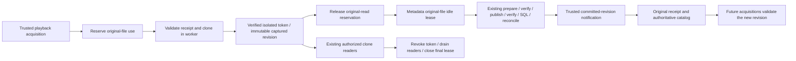

# Playback-compatible FLAC metadata editing — Phase 2E.4C

`RIO_STABLE_PLAYBACK_SOURCES=1` permits the existing inline and Track Info editors
to publish metadata to a managed FLAC original while Rio plays a verified APFS
clone. The switch remains disabled by default. Keep Organized must be OFF.
Referenced media, other formats, unverified capture, original-file playback,
conflicting operations and unsupported publication environments remain excluded.

## Coordination and revision ownership



The unchanged `MetadataUseGate` protects **original-file** use. All acquisitions
first reserve original use, so capture/hash/revalidation and fallback readers are
excluded during a metadata lease. Only a fully verified clone, with the internal
flag enabled, relinquishes that reservation. A failed, pending or unsupported
capture never establishes concurrent-edit authority. Original readers continue to
hold the gate through final reader drainage. Retiring an isolated token does not
change an original-file gate locked by metadata editing.

Each isolated lease retains an immutable original revision fingerprint (managed
root, relative location, device, inode and digest). Playback-use also tracks the
current managed-original revision for that logical track. The coordinator's
optional `committedRevision(previous, next)` notification runs only after verified
publication and SQL commit, including verified forward reconciliation. Main checks
both the captured lineage and the committed receipt before advancing that expected
revision. Unknown changes fail closed. The captured clone fingerprint never
changes, and clones never become catalog or recovery authority.

Existing isolated tokens may read their old revision while a journal masks the
original. This narrow exception exists in both the protocol guard and source
ownership validation. It requires the same owner, active Library, ID/path/format,
managed-root binding and live isolated capability. New original requests still
fail; a renderer cannot choose a path, source kind, revision or publication mode.
The private worker/native source remains read-only and unlinked. Every original
read and capture revalidation finishes before the original-use reservation is
released; subsequent decoder reads address the clone exclusively.

The source manager validates retained catalog/root authority independently of the
original's journal/availability status. A known worker failure revokes concurrent
eligibility. An original marked missing by existing recovery rules does not turn
a verified clone into a replacement original reader; new captures and edits still
require the original to pass their normal checks.

## Player and editor behavior

Both editors use the existing Phase 2C IPC, coordinator and writer. No new editor
API, automatic stopping, optimistic success, retry engine or saving notification
is added. Enter exits immediately; Tab retains its existing navigation. Failed
proposals retain Review edit / Discard edit and diagnostic references.

Pause, Resume and seek retain the attached isolated token. Flagged source reuse
also covers an outstanding seek/buffering interval, avoiding a new acquisition
while the original is locked. Forced source replacement and decoder errors retain
their established release paths. Metadata completion updates catalog metadata; it
does not restore an earlier playback selection or transport intent.

Clone capture retains the library-operation serialization rule. If another
track's metadata operation is busy, unrelated playback may deliberately use its
existing original-file route under its own gate. That track remains read-only
while attached; switch away and reacquire after the operation for isolated use.
There is no fallback after an attempted isolation capture fails.

Quit revokes playback authority and waits for active coordinator leases before
closing the database. Safe abortion/reconciliation and the existing journal remain
responsible for interrupted saves. The existing in-place limitations remain:
verification failure may reconcile forward when exact candidate bytes are provable;
unverifiable output is marked missing for Locate File. No new rollback guarantee
is claimed.

## Qualification and measurement

`node scripts/player-stable.mjs --metadata` extends the real Electron player
harness, in source or established `--packaged` / `RIO_EXECUTABLE` mode. It drives
Songs cells and Track Info Save through production preload/IPC and coordinator.
The internal worker-reply seam holds preparation or post-publication verification
for deterministic interaction/fault tests; it does not grant eligibility or replace
the writer. Natural runs are reported separately from deliberately held saves.

Checks cover active and paused saves, Enter/Tab, no-op/cancel, repeated edits,
Pause/Resume/seek, switching during a save, failed draft retry, old-revision protocol
bytes during a journal, unauthorized tokens, new-revision acquisition, recovery,
quit during preparation, renderer/window teardown, ID/path/favourite/playlist
preservation, audio-byte preservation and unchanged external inputs. A separate
mode holds preparation before detaching only its own disposable APFS image. It
checks unchanged receipts, no write-start intent and a retained failed draft.
Both the earlier pre-submission variant and the strengthened packaged
volume-loss-during-preparation follow-up passed.

Timings use monotonic clocks. The renderer samples the real HTMLAudioElement every
25 ms. Publication brackets align process time origins and surround the measured
publication stage; they include sampling uncertainty. Intentional seek/pause
transitions are marked and are not interpreted as continuous position advancement.
Stable token, no unexpected emptied/error event, advancing currentTime and retained
readiness establish transport/decoder-state continuity, **not** PCM sample or
acoustic continuity. No CORS, protocol authorization or media security setting is
changed for measurement.

Detailed measurements, final validation results and resource fingerprints are in
`PLAYBACK-COMPATIBLE-METADATA-RESULTS.json`.

## Recorded results (Intel macOS, 2026-11-09)

- Full unit suite: 552 passed, one existing skip across 26 files.
- Final full source desktop suite: all 20 harnesses passed.
- Full packaged desktop suite: all 19 harnesses passed.
- Additional packaged noowners, external large-file metadata, volume-loss-during-
  preparation and flag-disabled lifecycle runs passed,
  using both `--packaged` and `RIO_EXECUTABLE`. Packaged/source production-resource
  fingerprints match. Old-tag protocol bytes remain bound to their captured
  revision during journals; unauthorized tokens fail.
- Typecheck, build, formatting and whitespace checks passed. The unsigned x64
  app, DMG and ZIP built with `--publish never`; Rio name/identifier/architecture
  are verified. ZIP critical resources match the app and the DMG checksum is valid.

Representative natural packaged saves (single-run observations, not latency
percentiles; main IPC duration includes validation through snapshot):

| Storage / fixture                             | Main save | Renderer submission → reply/frame | Tab editor exit | Largest main-loop gap |
| --------------------------------------------- | --------: | --------------------------------: | --------------: | --------------------: |
| Owned APFS, 189,243 bytes                     |    791 ms |                            798 ms |          4.2 ms |                164 ms |
| Disposable noowners APFS image, 189,243 bytes |    273 ms |                            277 ms |          3.3 ms |                7.9 ms |
| External APFS noowners, 44,487,552 bytes      |  3,850 ms |                          3,853 ms |          2.9 ms |                255 ms |

The large fixture's position advanced 0.272 s across a 273.6 ms bracket around
publication, with readiness 4 and no emptied/error event. Its paused Track Info
save retained the source and position; renderer completion took 3,838 ms. The
controlled active Enter case exited in 6.8 ms; Pause/Resume/seek during held
preparation were observed in 27/32/16 ms including test command overhead. Later
acquisition used the committed revision: 417 ms verified preparation, 888 ms
through observed playback readiness/polling. These results retain metadata save
latency and synchronous main stalls; they do not establish PCM/acoustic continuity.

A late follow-up initially observed playing/readyState 4 with currentTime frozen
at 0.032 s before any edit. The flag-disabled original-file path reproduced it.
After the user confirmed audio worked in another app, both outstanding packaged
checks passed on retry: volume loss during held preparation failed before
publication with its original receipt unchanged and its draft retained; the
flag-disabled lifecycle completed normally with zero isolated sources. No audio
settings, production code, fixture, readiness assertion or timing threshold changed
for these retries. The cause of the transient clock observation was not established;
it no longer blocks qualification. Manual acoustic acceptance remains separate.

## Known limits

- Qualification is Intel macOS on local writable APFS, including noowners. Other
  platforms retain original-file playback restrictions; no clone support is claimed.
- Metadata latency is retained, not optimized in this phase. Existing synchronous
  native publication/capability/durability work can stall main; clone playback is
  isolated from the rewritten original, but commands requiring main can wait.
- Existing size, free-space, source-count, reader and scratch-state bounds remain.
- The earlier raw large transport fixture has a lowercase ENCODER field that the
  existing writer correctly rejects when TagLib normalizes it. This restriction
  remains. The large save benchmark uses the Phase 2D.3 fixture method: canonical
  synthetic Vorbis tags around byte-identical encoded audio. The input fixture is
  only read, and production preservation checks are unchanged.
- Acoustic continuity and other hardware/arm64 distributions require separate
  qualification. An unavailable volume can still exhaust already-buffered audio;
  no fallback to an unverified original is permitted.

## Manual acceptance

1. Quit Rio completely. From the repository root, run the following command to
   launch the fresh unsigned app with the flag.

   ```sh
   RIO_STABLE_PLAYBACK_SOURCES=1 "./release/mac/Rio.app/Contents/MacOS/Rio"
   ```

2. Start with a disposable library and managed FLAC on writable local APFS. Turn
   Keep Organized OFF. Play the track and wait until playback is established.
3. Edit Genre inline with Enter, then Tab. Try Track Info Save while playing and
   paused. Check that normal saves stay quiet, audio remains on the established
   source, and Pause/Resume/seek work. Switch to another track during a save and
   confirm completion does not switch back.
4. Check updated fields, playlist/favourite references and same file location.
   Quit/reopen and verify persistence. Review any failure through the retained
   draft and diagnostic reference; preserve files if recovery is requested.
5. Quit and launch without the flag. Active/paused original playback must again
   block editing. Referenced files, non-FLAC and Keep Organized ON stay read-only
   in either mode.

## Files changed in Phase 2E.4C

| File                                             | Purpose                                                                                   |
| ------------------------------------------------ | ----------------------------------------------------------------------------------------- |
| `src/domain/metadata-edit.ts`                    | Original-use contract and verified committed-revision notification                        |
| `src/main/playback-use.ts`                       | Original reader reservations, isolated-use eligibility, revision lineage and token checks |
| `src/main/stable-source-manager.ts`              | Immutable capture revision, retained root/catalog authority and worker availability       |
| `src/main/main.ts`                               | Authorized isolated protocol continuation and existing-source availability checks         |
| `src/main/metadata-editor.ts`                    | Actionable revision/source failure mapping                                                |
| `src/renderer/media-source.ts`                   | Retain the acquired flagged source during seek/buffering                                  |
| `tests/stable-source.test.ts`                    | Concurrent/exclusive use, revisions, failure, release and authority regressions           |
| `tests/media-source.test.ts`                     | Outstanding-seek source retention regression                                              |
| `scripts/player-stable.mjs`                      | Metadata mode, packaged provenance, fixture setup, lifecycle integration and diagnostics  |
| `scripts/lib/stable-metadata.mjs`                | Real UI/save/transport/failure/recovery qualification and measurements                    |
| `package.json`                                   | Add metadata integration to source/packaged suites and focused command                    |
| `docs/METADATA-EDITING.md`                       | Document the opt-in isolated-source exception                                             |
| `docs/INLINE-METADATA.md`                        | Clarify original-file exclusion and link this qualification                               |
| `docs/PLAYBACK-COMPATIBLE-METADATA.md`           | Coordination, evidence, limits and manual instructions                                    |
| `docs/PLAYBACK-COMPATIBLE-METADATA-RESULTS.json` | Structured results and artifact/resource fingerprints                                     |
