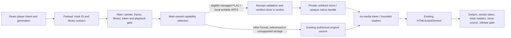

# Stable playback sources: real player integration (Phase 2E.4B)

The internal `RIO_STABLE_PLAYBACK_SOURCES=1` switch lets the existing Electron
player use the Phase 2E.4A APFS source manager. The default remains disabled.
This phase does **not** permit editing an actively acquired or paused track.

## Source selection and authority

The renderer receives the existing opaque `rio-media://` lease. It never receives
clone paths, handles, filesystem credentials or a strategy selector. The preload's
boolean feature indication controls only transport intent handling.

The Phase 2E.4B qualification used a 64 MiB per-file source budget. A worker
classifies the current root through checked directory descriptors. Known
unsupported storage uses the existing authorized playback path, after the probe
worker closes. Missing/replaced/inaccessible roots and any failure after isolation
selection are errors: there is no fallback following clone, receipt, space or I/O
failure. Unsupported platforms keep the original playback path.

The source retains the original logical track's playback-use gate and token scope.
Active, paused, buffered and attached ended sources still block metadata edits.
Metadata idle leases still prevent new acquisition. Receipt/revision validation,
publication exclusion, reader limits and final-use cleanup remain the Phase 2E.4A
implementation.

## Transport and bounded preparation

Flagged acquisition waits for the previous cancelled capture and its release before
starting the newest selection. Intermediate superseded requests do not acquire a
source. Generation/request checks prevent a late grant from overriding a newer
selection or Pause. Pending seeks apply to the eventual selected source; a later
Pause cancels autoplay while retaining attached decoder ownership.

The existing restored-current-track preload already prepares a source without
playing it. Play reuses this verified source. No next-track prefetch, persistent
cache or extra speculative clone is introduced. The manager's existing two-source,
128 MiB logical budget and reader bounds applied in that qualification. This phase does not
promise instant cold start: receipt and clone verification still complete before
attachment, away from the main event loop.

## Qualification

In the results, `<historical-package-dir>` denotes the temporary package output
directory used for the Phase 2E.4B run.

`scripts/player-stable.mjs` drives the real Songs and transport controls. It uses
the same `--packaged` / `RIO_EXECUTABLE` convention as the existing desktop tests.
Production modules are resolved from `app.getAppPath()`; packaged mode asserts
`app.isPackaged`, records resource hashes, and exercises the packaged worker and
matching native addon. It does not import production code from checkout `dist`.

Options select disposable external-volume fixtures, a temporary APFS/HFS+ image,
feature-disabled mode and a known disposable large FLAC. The harness exercises
Play/Pause/Resume, seeking, Next/Previous, end of track, retained playback exclusion,
unauthorized token rejection, delayed acquisition with Pause/seek/switch, injected
ENOSPC/EIO with no fallback, real invalid-FLAC decoder failure, current-source
removal, library switching, restored preload reuse, window destruction/reopen, renderer crash and application
quit. It checks original input hashes and mtimes. The volume-removal option force
detaches only its own disposable APFS image and checks that new use is rejected.

Timing uses monotonic clocks. `loadeddata` measures Chromium's first decoded-data
availability; `seeked` measures decoder seek completion. These and advancing real
HTMLAudioElement time establish decoder/transport behavior, **not** sample-level
PCM, acoustic continuity or absence of audible underruns. No media CORS or
production protocol policy is changed to obtain these measurements.

## Findings and measurements

Real Chromium playback exposed a shared-source lifecycle defect not exercised by
small buffered fixtures: cancelling one range body injected an exception at the
async generator's `yield`, and its broad catch retired the entire clone. A 44.5 MB
FLAC repeatedly received 503 responses. The correction puts reader cancellation
outside the I/O/authority catch. Cancelling a reader now closes that reader only;
actual read, length or authority failures still retire the source. Explicit lease
release still revokes tokens, destroys/drains every reader and closes the worker.
The new protocol-body-cancellation regression failed before this correction and
passes afterward, including another range and metadata-gate exclusion.

A second issue concerned only pending transport feedback: Pause before acquisition
completed could retain the previous playing indicator. Flagged Pause now clears
that indicator explicitly, while preserving the acquired source and its gate.

Representative first-acquisition measurements on Intel macOS 15.8.1, Electron
44.9.2 (single runs, not distributional latency guarantees):

| Storage / mode                           | FLAC bytes | Play → decoded data |         Verified preparation | Native clone/setup | Largest 5 ms sampler gap |
| ---------------------------------------- | ---------: | ------------------: | ---------------------------: | -----------------: | -----------------------: |
| External APFS noowners, source app       | 44,487,499 |            412.7 ms |                     395.4 ms |            0.29 ms |                   6.5 ms |
| Disposable APFS noowners image, packaged |    189,243 |             71.0 ms |                      48.9 ms |            0.30 ms |                   5.8 ms |
| Disposable HFS+ image, packaged fallback |    189,243 |             62.8 ms | 39.5 ms classification probe |                  — |                   6.5 ms |
| Local APFS, packaged flag disabled       |    189,243 |             21.7 ms |         No clone preparation |                  — |                        — |

The later large-file run also sampled the full initial Play window: maximum main
loop gap 13.7 ms, with worker construction 2.48 ms. A fresh packaged owned-APFS
run measured 69.6 ms to decoded data, 50.2 ms verified acquisition, 2.17 ms worker
construction and a 12.6 ms maximum main-loop gap. The table's gap column measures
capture only, and includes the intended 5 ms sampling interval.

Switching from the large source to the small source reached decoded data in
68.3 ms; switching back took 401.2 ms. The large-fixture seek completion was
observed within 120 ms, including Playwright command/poll overhead. These
measurements show the cost of verified acquisition, not an optimization claim.
Restored preload reuse was explicitly verified to create no additional source on
Play. Hashing, native capture and positional reads remain in the worker.

The complete source/packaged validation outcomes and resource fingerprints are
recorded in `STABLE-PLAYBACK-PLAYER-RESULTS.json`.

Final validation passed:

- Focused source/ownership units: 57 passed, one existing skip.
- Full unit suite: 542 passed, one existing skip across 26 files.
- Full source desktop suite: all 19 harnesses passed, including real-player
  integration; full packaged suite: all 18 passed with `RIO_EXECUTABLE`.
- Explicit `--packaged` plus executable override, disabled mode, HFS+ fallback,
  disposable noowners volume loss, and the external large-file run passed.
- Existing native volume qualification rerun passed on ownership-enabled and
  noowners APFS: clone independence under staged/in-place publication, forced
  detach EIO, read-only EROFS, real ENOSPC without scratch leftovers, cross-volume
  EXDEV and unsupported HFS+ ENOTSUP.
- Typecheck, build, Prettier and whitespace checks passed.
- Temporary unsigned x64 app-directory build passed with `--publish never`;
  Rio name and `io.github.marcelchapman.rio` identity verified. Main, preload,
  playback, worker, coordinator, renderer index and native addon fingerprints
  match the source qualification build. Existing release artifacts were retained.

## Remaining limits and readiness

- Qualified runtime coverage is Intel macOS/APFS; Linux, Windows and arm64 clone
  integration are not qualified. Unsupported platforms retain original playback.
- Cold acquisition still waits for full receipt/clone verification. Serialized
  cancellation can wait for a superseded bounded capture to finish.
- Existing resource and free-space limits remain conservative. Existing unknown
  scratch-state refusal and the Phase 2E.4A crash-window limitations remain.
- Buffered audio may continue temporarily after volume removal; new use is
  rejected and revocation/drainage remain authoritative. The image-removal test
  verifies safe new-use rejection, not sample-exact interruption timing.
- Tests observe the actual decoder and transport but do not qualify audible
  continuity, PCM sample continuity or underrun absence.
- This is ready as a flag-disabled foundation for a later concurrent-editing
  phase. It deliberately keeps the metadata idle-use exclusion on active/paused
  tracks; concurrent metadata editing is not enabled or qualified here.

## Integration files

| File                                       | Change in this phase                                               |
| ------------------------------------------ | ------------------------------------------------------------------ |
| `native/playback-source.cc`                | Descriptor-bound, read-only storage classification                 |
| `src/main/stable-source-worker.ts`         | Worker capability selection before capture                         |
| `src/main/stable-source-manager.ts`        | Selected-source API and reader cancellation isolation              |
| `src/main/playback-use.ts`                 | Real-player selection with the same logical gate/token             |
| `src/main/main.ts`                         | Trusted playback acquisition routing and concise failure text      |
| `src/main/preload.cts`                     | Read-only internal flag indication                                 |
| `src/shared/types.ts`                      | Corresponding preload flag type                                    |
| `src/renderer/media-source.ts`             | Cancelled-acquisition drainage and pending seek position           |
| `src/renderer/App.tsx`                     | Flagged transport intent, Pause/Next and pending seek handling     |
| `tests/media-source.test.ts`               | Superseded acquisition and pending seek regressions                |
| `tests/stable-source.test.ts`              | Selection, failure, fallback and protocol cancellation regressions |
| `tests/metadata-fixtures.ts`               | Optional nonzero deterministic constant PCM fixture                |
| `scripts/player-stable.mjs`                | Real-player source/packaged lifecycle qualification                |
| `package.json`                             | Add the harness to desktop and packaged suites; focused command    |
| `docs/STABLE-PLAYBACK-PLAYER.md`           | Architecture, findings, measurements and limitations               |
| `docs/STABLE-PLAYBACK-PLAYER-RESULTS.json` | Qualification results and resource fingerprints                    |

See [Large FLAC support](LARGE-FLAC.md) for Phase 2E.6 range and resource
qualification. Clone logical size is not a measurement of unique physical storage.
