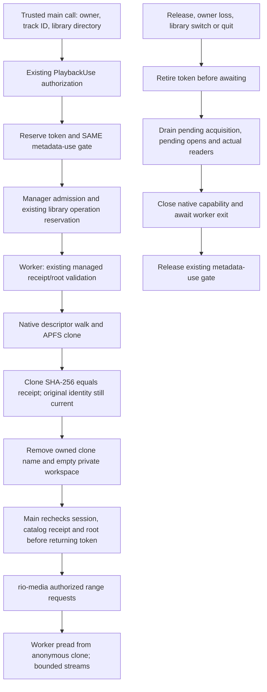

# Stable playback source manager — Phase 2E.4A

## Scope and default behavior

Rio now has dormant main-process infrastructure for managed FLAC playback from
an anonymous APFS clone. This does **not** enable concurrent metadata editing,
change metadata eligibility, or select a different source in the visible player.
No renderer, preload, shared API or metadata coordinator change was made.

The internal opt-in is `RIO_STABLE_PLAYBACK_SOURCES=1`. It arms the manager only;
the existing `playback:acquire` handler still calls `PlaybackUse.acquire`, which
serves the original file exactly as before. Only an explicit trusted-main call
to the new `PlaybackUse.acquireIsolated` requests a clone. There is no new IPC
endpoint, preference or renderer-supplied strategy. An unset flag refuses this
internal method before filesystem access. Linux and Windows cannot invoke the
native APFS factory; there is no automatic full-copy fallback.

The pre-implementation working tree contained 17 modified tracked files for
Phase 2D inline editing, responsiveness, parser performance and diagnostics.
Its additional UI helpers/tests and Phase 2E.1–2E.3 research scripts/reports were
also present. All that earlier work was preserved byte-for-byte. The three
pre-existing files changed for this mission were previously clean:
`main/playback-use.ts`, `main/media.ts`, and the native build driver.

## Files

Added:

- `src/main/stable-source-manager.ts`: admission, bounds, leases and worker RPC.
- `src/main/stable-source-worker.ts`: receipt validation, hashing and native reads.
- `native/playback-source.cc`: descriptor-bound, read-only APFS clone capability.
- `scripts/build-playback-source-native.mjs`: separate Node-API 8 build/manifest.
- `tests/stable-source.test.ts`: deterministic lifecycle and real native tests.
- `scripts/stable-playback-source.mjs`: actual Rio protocol/decoder qualification.
- `scripts/stable-playback-volume.mjs`: disposable APFS/HFS+ volume qualification.
- This report and `STABLE-PLAYBACK-SOURCE-MANAGER-RESULTS.json`.

Modified:

- `src/main/playback-use.ts`: internal isolated acquisition and source drainage.
- `src/main/media.ts`: shared range-response construction for a read capability;
  the original pathname implementation keeps its stat/error/header semantics.
- `scripts/build-publication-native.mjs`: builds the separate dormant addon too.
  Publication exports and publication source are unchanged.

## Authority and lifecycle



The source manager accepts a trusted `Library`, track ID and session assertion,
not a renderer path. It requires a present managed FLAC, its configured root,
current receipt, no pending managed import or metadata journal, and no conflicting
library operation. It temporarily owns `Library.scanning` during capture, using
the same operation exclusion respected by settings, import, relocation and
metadata editing. It releases that reservation only after capture/failure cleanup.
Original content, track ID, settings and catalog relationships are not modified.

The worker checks the actual input size/link type before hashing, so a stale
indexed size cannot admit an oversized target. It then reuses **unchanged**
`validateCurrentManagedReceipt`, with a read-only
SQLite connection. Native code opens every root/relative-parent component
without following symlinks and binds root and original device/inode identities.
This qualification required a single-link regular file of at most 64 MiB.
Native code checks local writable APFS and free space, then clones from the
retained original descriptor. Immutable,
append-only and dataless originals are refused before scratch creation. Relative
parents and the original must remain on the configured root volume.

The clone has a different inode. A randomly named private directory is created
inside the configured managed root; its known clone name and empty directory
are removed before capture returns. The read-only native object stays in the
worker. Main and renderer never receive its filesystem path or descriptor.
Worker hashing verifies the entire clone against the captured receipt digest;
a final native check revalidates the original identity/timestamps and ancestors.
Main rechecks receipt/root/catalog/session state before issuing the token.

A token remains tied to owner, current library, track and captured source object.
The existing `source()` checks still apply to every protocol request; manager
reads additionally check the managed location/settings and native root ancestry.
There is no exception to `Library.media()` for pending metadata journals.
An unavailable/missing track, revoked session or changed root cannot be made
playable merely because an old descriptor remains readable.

All clone I/O uses positional reads in a per-source worker. There is no main
`clonefile`, full-file hash, synchronous file read, `/dev/fd` pathname reopening,
or metadata writer in this mechanism. The shared reader interface is portable;
only its APFS factory is implemented. Native binary architecture, Node-API level
and SHA-256 are checked in the worker before loading it.

### Two ownership obligations

A source has an explicit playback lease **and** outstanding readers. EOF or pause
is not lease release. Fully buffered and paused attached decoders keep the same
metadata-use gate held. The gate becomes idle only after explicit token release
or existing authority revocation, pending capture/open completion, actual reader
closure, native close and worker exit.

Pending acquisition is registered in `PlaybackUse.sources` before the first
asynchronous operation. Library rebinding cannot discard it. Owner destruction,
navigation, library switch and application quit reuse the existing revocation
paths. They retire admission immediately, wait for capture to fail/close, and
refuse late grants. Requests waiting for worker validation cannot open a stream
after release.

On `EIO` or other invalid source reads, physical resources retire and readers
are cancelled. The logical playback-use lease remains held until its explicit
release/revocation, so a failed read cannot accidentally enable metadata editing
while a decoder is still attached. Worker termination rejects outstanding RPCs;
its native finalizers close descriptors. Cleanup waits for that actual exit.
There is no timeout that guesses an unresponsive descriptor is safely closed;
uninterruptible OS I/O may delay drainage rather than release authority early.

## Bounds and scratch cleanup

- Two physical source slots per manager, including capture. Each reserves a
  worst-case 64 MiB source in this qualification, giving a 128 MiB logical source budget. No queue/cache.
- Two isolated token leases per `PlaybackUse`, including failed physical sources
  awaiting explicit release. Eight active readers per source, sixteen pending
  regular worker requests, and 256 KiB read chunks. Teardown can always queue its
  close command.
- Each worker has 96 MiB old-generation and 16 MiB young-generation heap limits.
  Full verification streams through bounded buffers rather than retaining a
  complete audio image in main memory.
- Root plus relative path depth is limited to 32 components to bound retained
  descriptors. Capture requires available space for the whole source plus
  16 MiB. This is a capture precaution, not a promise of space for future concurrent
  publication; concurrent edits remain disabled.

After unlink, normal cleanup requires only stream drainage and descriptor close.
No durable duplicate or general-purpose cache is retained. A process crash between
name creation and unlink can leave private scratch state. Unknown
`.rio-playback-*` entries cause further capture on that root to be refused;
the implementation does not recursively delete or adopt them. Normal failure
cleanup removes only the just-created, identity-matching clone and empty private
directory. Unfamiliar replacements or incomplete cleanup are retained safely.
This bounds repeated creation after an orphan and avoids destructive cleanup of
arbitrary managed media. A user-facing orphan recovery policy is deferred.

A clone on a disconnected external drive is not an offline backup. Native ancestry
and read checks fail; the manager closes the source without selecting another
path, copying elsewhere or changing the configured media root.

## Qualification

Automated unit coverage includes disabled/ordinary acquisition, managed-only
eligibility, receipts, missing targets, symlinks, append-only originals, unknown
scratch entries, stale revisions during capture, authorization, cancellation,
concurrent/outstanding readers, reader/source bounds, source switching, owner and
application teardown, I/O failures, repeated release, and unexpected worker exit.
Four forced worker terminations were checked for descriptor growth. An isolated
lease still rejects metadata editing before playback and while a real decoder
is paused. Queue/current references retain their existing behavior.

The source desktop harness uses the actual Rio app, existing protocol and a real
muted HTMLAudioElement decoder. The existing renderer acquisition is first proved
to allocate **zero** stable sources, even with the flag armed. Internal isolated
acquisition then exercises small/large files on the internal APFS volume and the
real external APFS `noowners` disk. Source switch, library switch with an outstanding
lease, paused ownership, stale URL refusal, renderer crash and actual `will-quit`
resource drainage are checked. The actual Electron runtime also passed byte-backpressure qualification (two
unconsumed chunks); the unit regression guards against whole-source read-ahead.
All fixtures are disposable; no real library is
opened. The large generated input is hashed before/after.

The volume harness mounts only disposable images. Both ownership modes passed:

| Case                                                            | Result                                                 |
| --------------------------------------------------------------- | ------------------------------------------------------ |
| Real metadata publication on original, retained clone unchanged | Staged on ownership-enabled APFS; in-place on noowners |
| Forced image detach                                             | Actual EIO; protocol 503; resources drained            |
| Read-only image                                                 | EROFS; no source granted                               |
| Filled image / insufficient capture space                       | ENOSPC; no scratch residue                             |
| Relative parent crosses filesystem boundary                     | Native EXDEV                                           |
| HFS+ image                                                      | ENOTSUP                                                |

The publication-independence test retains a **non-decoder inspection capability**
while editing the original with a genuinely idle playback service. It reads the
clone after commit/recovery. It does not bypass a decoder lease or demonstrate
concurrent playback editing. Existing production active/paused editing remains
blocked, and metadata journals still hide the original from playback.

### Performance

Final real-app measurements on macOS 15.8.1 x64, Electron 44.9.2 / Node 24.22.0:

| Storage / size                            | First acquisition (ms) | Repeated acquisitions (ms) | Largest 5 ms main timer gap (ms) |
| ----------------------------------------- | ---------------------: | -------------------------- | -------------------------------: |
| Ownership-enabled APFS / 189,632 bytes    |                   55.5 | 36.8 / 36.4                |                              5.9 |
| Ownership-enabled APFS / 44,487,499 bytes |                  770.9 | 844.8 / 392.6              |                             64.1 |
| External APFS noowners / 189,632 bytes    |                   41.4 | 37.7 / 39.5                |                              6.1 |
| External APFS noowners / 44,487,499 bytes |                  597.9 | 457.1 / 410.0              |                             11.4 |

The native clone/open/unlink/check phase took **0.26–0.67 ms** in that run.
Worker construction on main took **0.29–1.61 ms**. Main-thread CPU over the entire
acquisition window was **2.45–27.07 ms**, including other app work and controller
checks; it excludes worker CPU. Clone I/O, receipt hashing and verification run
in the worker, not in those main-thread critical sections.

After a source existed, `audio.play()` resolved in 6.2–14.2 ms on repeated plays.
The first audio-device initialization took 271.1 ms and is reported separately
from source creation. Muted real decoder readiness/position advancement was
checked; this is not acoustic latency or an active-edit continuity test.

Other retained successful passes showed whole-app timer outliers of **98.9 ms**
and **146.2 ms**. The profile pass measured only 0.28 ms of synchronous worker
construction in its 98.9 ms outlier and 19.4 ms of total main-thread CPU across
that 798.6 ms acquisition window. This does not identify the exact cause of the
gap or distinguish all synchronous SQLite I/O from OS scheduling and other app
activity. No zero-stall or universally frame-fast acquisition claim is made, and
no unrelated optimization was introduced. Both passes are retained in the results
rather than replacing the noisy measurements with a favorable run.

These are small disposable catalogs and first/repeated runs per case, not
OS-cache-flushed measurements or a qualification of huge personal libraries.
The main timer samples at 5 ms and measures the complete app event loop, not
only this manager's synchronous CPU. No slow-volume/hardware worst-case latency
is promised. First audio-device initialization is distinct from clone acquisition.

### Validation results

- `npm test`: **533 passed, 1 skipped**, 26 test files. The skip is the
  non-macOS refusal case on this macOS host. Native and injected lifecycle cases
  ran; oversized actual files and append-only targets were also refused.
- Full `npm run test:desktop`: **passed**, including source build, startup,
  metadata coordinator, real playback ownership, Track Info UI/IPC, inline editing,
  smoke/features, indexing/interchange, acceptance, managed imports, relocation,
  recovery, removals, albums, summaries and playlist menus.
- New source-manager decoder harness: **passed** on actual ownership-enabled and
  external noowners APFS, small/large sources, three acquisitions each, plus
  library switch, active/paused gates, renderer crash and verified quit drainage.
- New disposable-volume harness: **passed** for both publication strategies,
  actual EIO after image detach, EROFS, ENOSPC, native cross-volume EXDEV and HFS+
  ENOTSUP. Normal source creation left no scratch cache.
- Typecheck, source build, Prettier and `git diff --check`: **passed**.
- Earlier Phase 2D production edits and all Phase 2E research retain their
  original bytes. The existing player acquisition/IPC and metadata coordinator
  semantics remain unchanged.

Run after an ordinary source build. Set `RIO_EXTERNAL_PARENT` to a writable
test directory on external APFS. The original Phase 2D.7 fixture is no longer
available. For a large-file run, add `--large "$RIO_DISPOSABLE_FLAC"` and supply
an existing disposable FLAC.

```sh
node scripts/stable-playback-source.mjs \
  --external-parent "$RIO_EXTERNAL_PARENT" \
  --output /private/tmp/rio-stable-manager-desktop.json
node scripts/stable-playback-volume.mjs \
  --output /private/tmp/rio-stable-manager-volume.json
```

The large generated fixture is optional; the repository-owned small fixture does
not require a machine-global encoder. Volume tests require the built-in macOS
`hdiutil`, operate only on temporary disk images, and restore/remove them afterward.
Native tests are skipped where APFS is unavailable; injected lifecycle tests and
unsupported-host refusal remain testable there. There is no packaging step here.

## Integration still required

The real player intentionally continues to acquire originals. Future integration
must explicitly choose the isolated method under the flag and preserve its
existing sender/frame/session validation. Unsupported capture must not silently
fall back to an original while claiming playback-compatible editing is safe.

Concurrent metadata editing requires a separate review of physical-original use
versus immutable-source use, journal admission, revision policy and recovery.
None of that policy was enabled or weakened. Keep Organized and referenced-format
editing restrictions are unchanged; creating a read-only clone is not metadata
write authority or a recovery receipt.

Packaged resource qualification, arm64, non-macOS factories, abrupt machine power
loss, truly unavailable hardware with uninterruptible I/O, and user-facing handling
of the tiny creation crash window remain outside this infrastructure qualification.
No production renderer changes or new playback experience are included.

The current Phase 2E.6 size/resource qualification is recorded in
[Large FLAC support](LARGE-FLAC.md). Earlier measurement results retain their
original fixture sizes.
