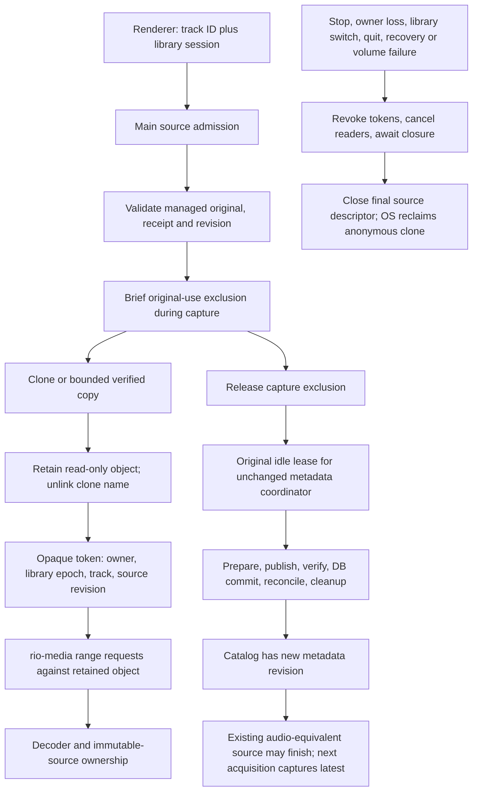

# Stable playback sources — Phase 2E.3 feasibility

## Conclusion

APFS clones are a viable way to isolate the decoder from managed FLAC tag
rewrites on both ownership-enabled local APFS and the real external APFS
`noowners` volume. The unchanged strong staged publisher and full-file in-place
publisher both left the clone byte-for-byte intact. An anonymous clone, retained
by a main-process read descriptor, can continue decoding without detaching the
source while the original is edited.

This is a research result, not permission to enable active-track editing in the
current player. Production still uses the Phase 2B track gate and rejects active
and paused attached targets. A future implementation must distinguish authority
over the mutable original from ownership of a verified immutable revision. Simply
substituting a clone pathname, declaring an active original idle, or ignoring
pending metadata journals would be unsafe.

Clones remove the required decoder handoff. They do not shorten the metadata
save, eliminate main-process stalls, make APFS `noowners` publication atomic, or
survive loss of the underlying volume. Acoustic output and worst-case hardware
underruns were not qualified.

## Reproducible experiment

macOS 15.8.1 (24H32), x86_64; source Electron 44.9.2. The ownership-enabled case
used disposable libraries under `/private/tmp`; the `noowners` case used random
scratch libraries directly on the repository's external volume, outside the
project/synchronization tree. Neither real library was opened. No volume options
on either real disk were changed.

Research files:

- [`stable-playback-source.mjs`](../scripts/research/stable-playback-source.mjs):
  dedicated Electron window, real HTMLAudioElement/FLAC decoder, AudioWorklet,
  production `MediaSource`, `PlaybackUse`, ranged-response implementation,
  coordinator, worker, WASM writer and native publisher.
- [`stable-source-clone.mjs`](../scripts/research/stable-source-clone.mjs):
  temporary C++ helper using `fclonefileat`, compiled outside the repository's
  build products. There is no copy fallback.
- [`stable-playback-storage.mjs`](../scripts/research/stable-playback-storage.mjs):
  bounded disposable APFS disk image, mounted separately with ownership on/off,
  allocation, process-death, exhaustion and disconnection experiments.
- [`STABLE-PLAYBACK-SOURCE-RESULTS.json`](STABLE-PLAYBACK-SOURCE-RESULTS.json):
  monotonic per-operation timings, decoder observations and identity assertions.
- [`STABLE-PLAYBACK-STORAGE-RESULTS.json`](STABLE-PLAYBACK-STORAGE-RESULTS.json):
  controlled-container allocation and lifecycle observations.

Use existing build products and dependencies, plus FFmpeg. Set
`RIO_DISPOSABLE_FLAC` to a disposable large FLAC and `RIO_EXTERNAL_PARENT` to a
writable test directory on the same APFS volume as the repository. The original
Phase 2D.7 fixture is no longer available. The sizes and results below describe
that historical run. For a small-fixture player experiment, pass `--small-only`
and omit `--large`.

```sh
node scripts/research/stable-playback-source.mjs \
  --external-parent "$RIO_EXTERNAL_PARENT" \
  --large "$RIO_DISPOSABLE_FLAC" \
  --output /private/tmp/rio-stable-source-results.json
node scripts/research/stable-playback-storage.mjs \
  "$RIO_DISPOSABLE_FLAC"
```

No dependency installation or application packaging is involved. Temporary test
libraries, cloned objects, native helper, profile and disk image are removed by
the harnesses. The existing generated large input is hashed before/after and
retained unchanged for repeatability. The small 60-second stereo tone FLAC is
1,097,433 bytes after canonical fixture tags; the seeded-noise 180-second large
FLAC is 44,487,522 bytes. Both are independently decoded by FFmpeg before use.
The original generated large input is 44,487,499 bytes; only the disposable copy's
comment block is normalized, as in the earlier studies.

### What is real and what is simulated

The decoder, protocol streams, main-process file descriptors, use gates,
coordinator, native publication, full preservation verification and journal
recovery are real. No production module is rewritten or bypassed. The research
window and its narrow preload/IPC are temporary lab transport, not Rio's React
transport, Track Info or inline editor. Main derives all original/clone paths
from the imported disposable library; the renderer sends IDs and opaque tokens.

Two unchanged `PlaybackUse` instances represent separate physical-resource
scopes: the managed original and the clone. Only the clone scope grants decoder
tokens. The original scope has no decoder acquisition and supplies the real
coordinator idle lease throughout the save. This separation is the architecture
being tested; the existing production singleton does not yet implement it.
The clone scope uses a main-owned facade to resolve exact retained descriptors;
it does not override `Library.media()` or production IPC.

An AudioWorklet measures actual decoded input in 128-frame quanta at 48 kHz.
It records energy, frame sequence and zero runs, flushes its last batch on demand,
and distinguishes planned pause/seek/switch operations from uninterrupted save
windows. A zero-gain destination avoids audible output. This detects silence,
missing quanta and media reload/stall events; it is not a bit-exact PCM sequence
comparison, speaker loopback, or OS/hardware xrun counter. Tiny flush-boundary
coverage differences are retained in the results rather than hidden.

Before/after-publication interruptions use existing coordinator hooks, followed
by its real recovery function. These are deliberate journal interruption points,
not electrical power loss or a failure injected inside a native syscall. The
storage study additionally induces an actual `ENOSPC` during a physical full-file
write, but does not present that primitive test as coordinator fault injection.

## Architecture and ownership



Production must register both metadata work and immutable resources under the
same library lifetime. It must never close the database or switch authority while
an operation is untracked. Original-use unknown state remains fail-closed.
A saved queue/current ID is still only a reference; pause retains the decoder's
immutable-source ownership. A legacy/original decoder still blocks editing.

The lab helper opens a regular, single-link source with `O_NOFOLLOW`, clones from
that descriptor into an exclusively created random scratch directory, checks
source identity/times again, and proves source/clone byte equality. Clones have
different inodes and `nlink == 1` initially. The main process retains a read-only
clone descriptor, removes its known newly created name, and checks `nlink == 0`
on final cleanup. Ranged reads use that object through `/dev/fd` in this macOS
experiment. The latter is a lab implementation detail, not a portable API.

The full proof includes repeated reads/hashes and costs much more than the clone
syscall. A future capture API must integrate the existing managed-root/receipt
validation, metadata-operation exclusion and exact revision evidence rather than
assuming a successful clone proves authorization. This study did not qualify a
new general filesystem security API or exclusion of hostile unrelated UIDs.

## Clone independence and playback results

| Storage / strategy                | Fixture        | Clone syscall (ms) | Verified source establishment (ms) | Play accepted after source exists (ms) | First save (s) | Repeats (s)   |
| --------------------------------- | -------------- | -----------------: | ---------------------------------: | -------------------------------------: | -------------: | ------------- |
| Local APFS / staged               | 1.10 MB tone   |              0.118 |                              24.23 |                                   40.1 |          1.156 | 1.041 / 1.037 |
| Local APFS / staged               | 44.49 MB noise |              0.123 |                             684.30 |                                   13.8 |          7.297 | 7.217 / 7.355 |
| External APFS noowners / in-place | 1.10 MB tone   |              0.153 |                              23.46 |                                    5.1 |          0.419 | 0.400 / 0.405 |
| External APFS noowners / in-place | 44.49 MB noise |              0.157 |                             749.93 |                                   10.3 |          3.750 | 3.580 / 3.565 |

Across 20 real-decoder save/fault windows, 62.96 seconds of decoded PCM were
observed without silent or missing quanta. Save timestamps and decoder windows
have different boundaries: the latter include controller polling, and the JSON
retains both rather than treating polling time as save duration.

First and repeated saves are separate observations, not cache-flushed tests.
There was no optimization of the writer or verification pipeline. The source
establishment timer includes native helper process startup, multiple full reads
and hashes, audio-region hashing, descriptor retention and unlink. Playback
start is `MediaSource.ensure` plus fulfillment of `audio.play()` after that
source exists; it excludes fixture import and clone validation and is not a
measurement of sound reaching a speaker. Those two timers should not be conflated.

All 12 uninterrupted saves preserved clone SHA-256, original encoded-audio
SHA-256, track ID, pathname, favourites, playlist membership and queue references.
Staged publication replaced the original inode; in-place publication retained
it. The decoder stayed attached to its original clone in both cases. All 20
continuous-save/fault observation windows had zero silent PCM frames and no
missing worklet quanta; uninterrupted-save windows had no waiting, stalled,
error, pause, ended or loadedmetadata events. Playback position advanced with
wall time. Active protocol readers were also present during large-file saves;
this was not solely a test of an already-closed decoder input stream.

A deliberately held, real pending save exercised pause/resume, seeking to 17 s,
switching to another track and reacquiring the original clone. Afterwards the
old token was drained, a fresh anonymous clone of the committed revision was
created, and playback reopened that revision. This tests replacement at release,
not seamless simultaneous versions of the same track. The existing
`PlaybackUse.source()` path check cannot model multiple same-track revisions by
merely replacing a mutable track-to-path entry.

Held-save seeking completed in 0.8–3.2 ms; track switching took 9.8–23.4 ms;
reacquisition of the existing source took 7.9–25.8 ms. These control tests occurred
at a deliberately held pre-publication boundary. They do not measure the worst
instant inside a synchronous native call.

Additional probes during the actual uninterrupted saves measured that distinction:

| Fixture / strategy | Largest main timer gap (ms) | Largest authorized 4 KiB range round trip (ms) | Renderer 50 ms timer's largest gap (ms) |
| ------------------ | --------------------------: | ---------------------------------------------: | --------------------------------------: |
| Small / staged     |                         198 |                                            187 |                                      52 |
| Large / staged     |                       1,222 |                                          1,196 |                                      52 |
| Small / in-place   |                          21 |                                              3 |                                      52 |
| Large / in-place   |                         380 |                                            379 |                                      52 |

All sampled authorized ranges returned 206. The range probe is a real main IPC
and retained-descriptor read, not a real production Play command or an uncached
Chromium seek. Decoder continuity held even with one real protocol reader active
at the start of every large save. Renderer timer gaps stayed close to the 50 ms
sampling interval; main-side stalls and new-command latency remain material.

The distinction matters: stable sources eliminate the mandatory detach and
restart, while synchronous work in main can still delay a new range request or
acquisition. Buffered decoder output survived those measured stalls; an
uncached seek at the worst instant is not guaranteed to respond within a frame.
A production proposal promising uniformly prompt new commands needs separate
qualification of this main-process work. No such refactoring was performed here.

### Comparison with the qualified handoff experiment

The [Phase 2E.1 results](METADATA-PLAYBACK-FEASIBILITY.md) already measured the
same generated large encoded audio. Its release/publish/reacquire design required
3.17–3.47 seconds of exclusive use on ownership-enabled APFS and 1.84–2.08 seconds
on external `noowners`. Observed decoder interruption was 3.74–4.18 seconds and
2.02–3.09 seconds respectively, including controller overhead. Small-fixture gaps
were 0.38–0.48 seconds, using a different small fixture.

The stable-source experiment has no release interval during a save and observed
no decoded-silence gap. This is an architectural comparison with retained earlier
measurements, not a controlled claim of faster saving or an acoustic A/B trial.
The E.1 coordinator was a temporary late-lease experiment; E.3 uses the unchanged
coordinator with an idle original throughout. Their diagnostics and transport
controller costs differ.

## Storage, cleanup and failure findings

Both ownership modes on the bounded 768 MiB disposable APFS image produced the
same allocation result:

| Observation                                                  | Result                                                                      |
| ------------------------------------------------------------ | --------------------------------------------------------------------------- |
| Four 44,487,499-byte clones, logical total 177,949,996 bytes | No measurable free-block delta at creation                                  |
| First full-file rewrite while clones retain old bytes        | 44,490,752 additional bytes allocated                                       |
| Second and third rewrites, same retained old revision        | No further sustained allocation growth                                      |
| Named orphan after descriptor-holder SIGKILL                 | Retained, then identity-checked unlink took 0.13–0.16 ms                    |
| Anonymous clone after its sole holder SIGKILL                | No pathname remained; 44,490,752 bytes reclaimed; process exit 3.24–3.45 ms |
| Cross-volume clone                                           | Rejected with cross-device error; no automatic copy                         |
| Physical full-file write under exhausted image space         | ENOSPC in both modes; clone SHA-256 unchanged                               |
| Retained read after force-detaching only the image           | EIO in both modes                                                           |
| Cleanup of the entire disposable owned tree after remount    | 137–145 ms; mounted image directory empty                                   |

The real decoder harness's final token drainage and descriptor cleanup took
2.31–6.24 ms across the four cases. New-revision clone verification took
23.69–558.08 ms (small/large and cache differences); playback acceptance after
that took 8.0–20.9 ms. These are separate from asynchronous APFS free-space
accounting, sampled at 250 ms intervals.

A benign named-clone replacement left its retained original descriptor bound to
the original bytes. The replacement was not adopted. Anonymous clones avoid that
pathname being available for later replacement altogether. This is object-binding
evidence, not a general hostile-user test.

APFS `st_blocks` counts blocks associated with each clone, including shared
extents; adding those figures would falsely report full copies. The controlled
image uses volume free-block deltas after bounded settling samples. A measured
zero at clone creation does not mean directory/inode metadata has no cost: it
means no additional allocation was visible at that accounting granularity.
Container metadata and transaction effects are included in the deltas.

Current in-place publication rewrites the whole candidate, so CoW retains a full
old audio image even though encoded audio is identical. Multiple clones of one
revision initially share that old image. Distinct simultaneously retained
revisions can each cost another complete track. The strong publisher already
needs its candidate/rollback space, in addition to a retained playback revision.
Cheap clone creation therefore must not be used as proof that a save has enough
space. Apple explicitly documents that later overwrites can fail with `ENOSPC`.

The main playback experiment uses anonymous clones, so normal release needs no
pathname deletion: revoke before awaiting, destroy all readers, await pending
opens/close acknowledgments, then close the final retained descriptor. Renderer
crash drained the live tokens; stale, unknown, wrong-track and wrong-owner token
operations were refused. Two simultaneous grants/readers of one immutable object
were tested. Forced main-process death is represented separately by an actual
killed descriptor-holder process, not by a simulated renderer event.

There is still a small creation-to-unlink crash window. A future implementation
needs a bounded, explicitly owned scratch area and conservative startup handling
for those identifiable orphans; never recursive cleanup of an arbitrary media
parent or user-selected directory. A manifest alone is not authority to delete a
replaced object. Unknown entries must be retained/refused within a bounded cache
policy. After unlink, no pathname-scavenging algorithm is needed for that object.

External disconnection makes retained descriptors fail; an immutable clone on
the disconnected disk is not an offline backup. Future policy must revoke the
source on confirmed volume/library authority loss and use existing recovery.
Already buffered audio is not proof that the volume is still available. Never
switch to another path or revision after a read error without fresh admission.

## Authorization and recovery requirements for production

- Keep sender/top-frame checks and the library/session binding in main. No
  renderer-provided pathname, descriptor, cache location or publication strategy.
- Issue capabilities for an exact immutable object/revision, not a public clone
  URL. Revalidate owner, epoch, track authority and source lifetime on every range
  request. Retain the original gate for every decoder that can read the original.
- Capture under real operation exclusion, verify identity and receipt evidence,
  and admit only a completed immutable source. Reject unknown state, replacement,
  non-regular files, link surprises, incomplete captures and exhausted budgets.
- Do not globally relax `Library.media()` for pending journals. A previously
  authorized, proven isolated source needs its own narrow read authority; it
  must not make an unfinished original available or authorize new snapshots of it.
- Successful audio-preserving metadata edits may update the catalog globally
  while an old immutable source finishes. Tokens must remain bound to that source
  revision. Reacquisition after release captures the latest verified original.
- Recovery-required, removed/missing tracks, library switching, owner loss and
  quit require an explicit revoke/drain policy even when the descriptor remains
  readable. A cache entry never grants write, managed-delete or recovery authority.
- Preserve existing original publication/recovery ordering, durable journal,
  receipt updates and error presentation. Stable playback cannot turn a partial
  in-place write into a successful edit. No clone should be treated as a durable
  rollback file or automatic recovery source.

## Cross-platform feasibility

| Environment               | Efficient isolation                                                                                         | Required fallback / qualification                                                                                  |
| ------------------------- | ----------------------------------------------------------------------------------------------------------- | ------------------------------------------------------------------------------------------------------------------ |
| macOS APFS, owners on/off | Descriptor-based CoW cloning worked on both actual volumes and the image                                    | Same-volume requirement; bounded space for later divergence; descriptor-based reader                               |
| Linux Btrfs               | Documented reflink/`FICLONE` independence                                                                   | Same filesystem and compatible CoW/checksum settings; runtime capability test and Linux qualification              |
| Linux ext4                | Do not assume reflink support; current upstream regular-file operations have no `remap_file_range` callback | Bounded full encoded-file copy or immutable encoded buffer, under original capture exclusion                       |
| Windows NTFS              | Do not assume ReFS block cloning applies to NTFS                                                            | Verified full copy or bounded encoded buffer; Windows handle/share/delete semantics need qualification             |
| Windows ReFS              | Microsoft documents block-clone isolation                                                                   | Runtime support, alignment and same-volume constraints; not NTFS evidence and not a newly supported Rio filesystem |

The platform-neutral abstraction should be an immutable, revision-bound,
read-at-offset capability with explicit close/revocation. Platform factories may
use APFS clones, Btrfs reflinks, full copies or bounded memory. Do not put
`/dev/fd`, APFS mount assumptions or a renderer-visible cache path in the shared
transport contract. Linux `O_TMPFILE` and Windows delete-on-close handles are
possible lifetime mechanisms, not qualified implementations in this study.

On this host Node's `COPYFILE_FICLONE_FORCE` returned `ENOSYS` on an APFS image,
while the native `fclonefileat` helper worked. API presence is insufficient;
capabilities need an actual test, and a failed clone must not silently become an
unbudgeted full copy.

A retained handle to the **original**, hard link, or ordinary private mapping
is not a substitute for an immutable snapshot: in-place tag writes can affect
the same underlying object. Controlled read-ahead alone only postpones the race
and does not cover seeking. A complete validated encoded buffer, bounded by the
existing editing size limit, is a plausible portable fallback. It requires full
read/copy time and memory per active revision; it was assessed, not implemented
or benchmarked on Linux/Windows. Fully decoded PCM buffering is larger and adds
decoder work. Neither alternative is needed to rescue APFS cloning in this test.

## Smallest justified future design and remaining limits

A narrow main-owned immutable source factory plus revision-bound protocol
capabilities is justified. Start with one active snapshot and a strictly bounded
switch/preload overlap, no persistent music cache or background queue. Charge
worst-case full file size per distinct revision against a count/byte/free-space
budget, even for cheap clones. Release retired snapshots after the last source
reader drains. Fall back only through an explicit bounded capability, or preserve
the existing active-original editing refusal.

Route every acquisition, including preload, restored current track, seek and
retry, through this factory. Keep original-use tracking and publication unchanged;
add separate immutable-source ownership and joint library teardown. Update UI
eligibility only when all real uses are proven isolated. Old or ambiguous uses
must continue to block editing.

Remaining qualification includes production React transport/IPC integration,
readmission policy during recovery, creation crash-window cleanup, simultaneous
same-track revisions, abrupt machine power loss, hardware/acoustic underruns,
worst-case uncached seeking during main-process stalls, sustained low-space
coordinator behavior, and Linux/Windows implementations. The disposable force
unmount tests are not electrical removal tests. No claim of atomic in-place
publication or hostile-user exclusion is introduced.

## Primary API references

- Apple's [`clonefile` / `fclonefileat` specification](https://github.com/apple-oss-distributions/xnu/blob/main/bsd/man/man2/clonefile.2): independent subsequent writes, descriptor-source variant, same-filesystem errors and deferred space exhaustion.
- [Btrfs reflink documentation](https://btrfs.readthedocs.io/en/stable/Reflink.html): independent changes and filesystem/CoW constraints.
- [Current ext4 regular-file operations](https://github.com/torvalds/linux/blob/master/fs/ext4/file.c): source evidence for the fallback assessment, not an ext4 runtime qualification.
- Microsoft's [block cloning on ReFS](https://learn.microsoft.com/en-us/windows-server/storage/refs/block-cloning) and [filesystem product behavior](https://learn.microsoft.com/en-us/openspecs/windows_protocols/ms-fsa/4e3695bd-7574-4f24-a223-b4679c065b63): documented ReFS support must not be generalized to NTFS.
- [Node file-copy flags](https://nodejs.org/api/fs.html#fspromisescopyfilesrc-dest-mode): forced cloning must fail rather than silently copy when unsupported.

## Verification performed

The source/decoder matrix completed 57 structured observations: four storage/size
cases, 12 uninterrupted saves, four held-save control sequences, eight injected
journal interruptions with eight recoveries, four new-revision reacquisitions,
authorization/concurrent-reader checks, renderer crash and final drainage. The
independent storage matrix completed both ownership modes including real ENOSPC,
forced process death and image detach. No production eligibility or publication
behavior was changed.

Focused existing regressions passed: **98 tests across four suites**
(`metadata-edit`, `metadata-editor`, `playback-use`, `media-source`). Prettier and
`git diff --check` passed for the research additions. All 161 pre-existing
source/native/test/script/document/config files retained their pre-study hashes.
No full desktop suite or package rebuild was necessary for these isolated
research additions; production application code and behavior were untouched.
